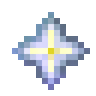
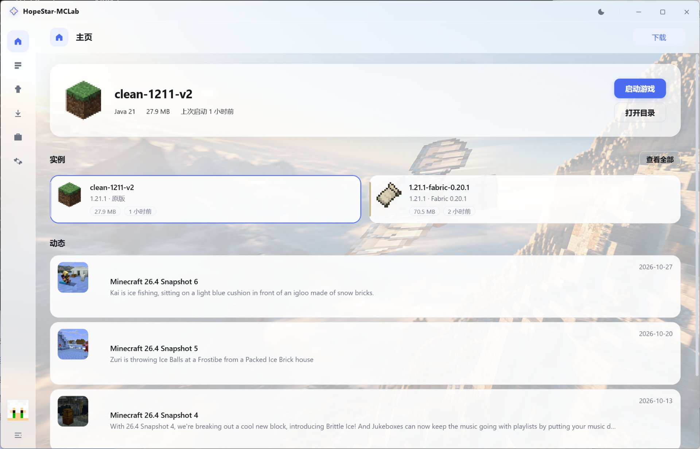
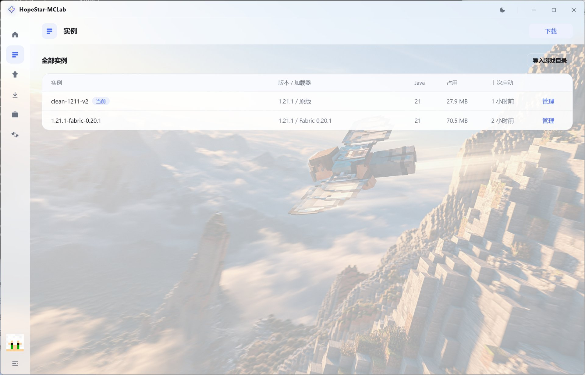
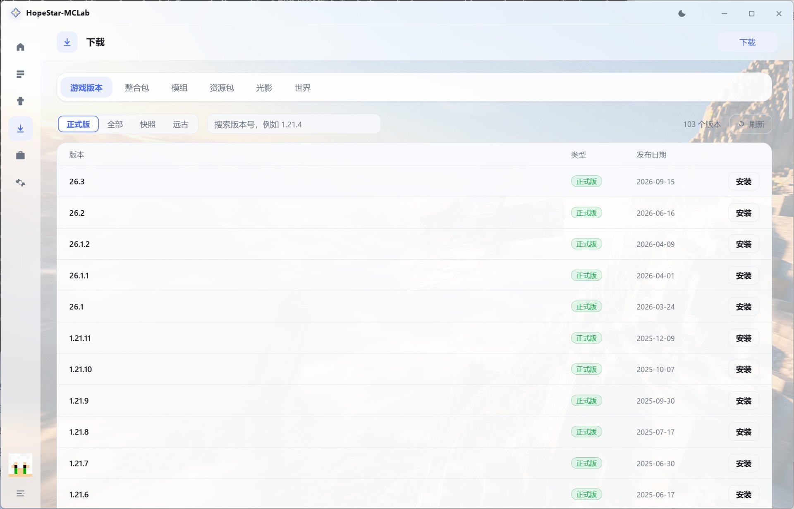
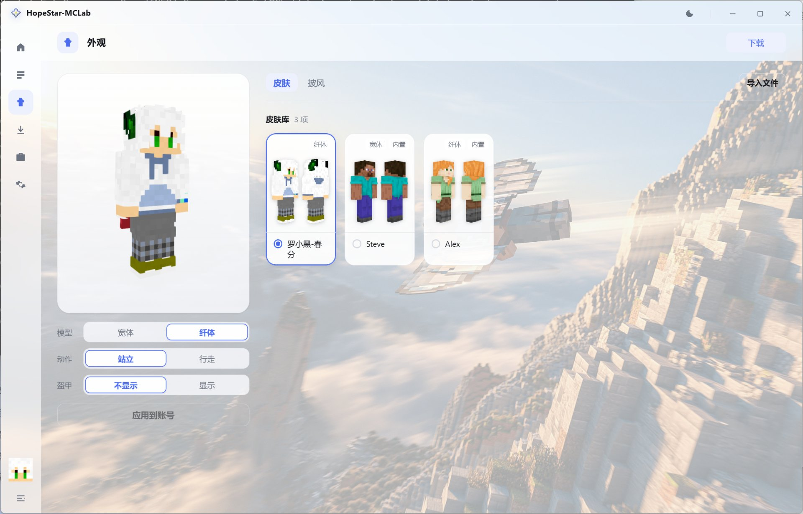
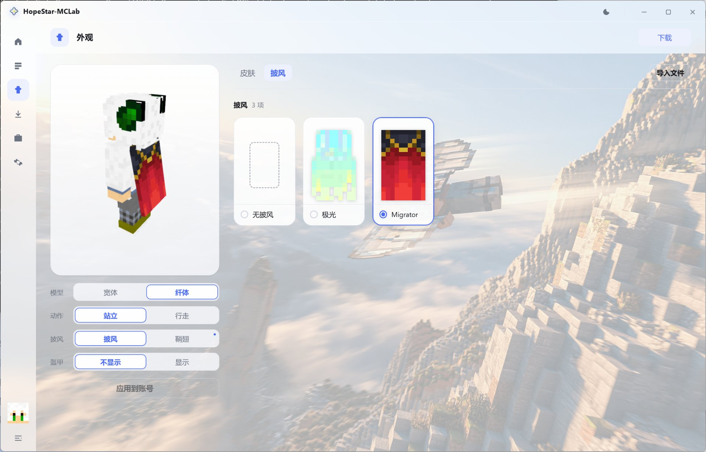

  
  <h1>HopeStar-MCLab</h1>
  
<b>一个开箱即用的 Minecraft 启动器</b> 
  Windows 10 / 11 · 免安装 · 免费开源

---

装游戏、装模组、换皮肤、开游戏，都在一个窗口里做完。
不用记 Java 参数，不用手动翻 `.minecraft` 目录，也不用手动解压整合包。

## 它长这样

### 首页 · 打开就能开游戏

最近在玩的实例摆在最上面，点「启动游戏」直接进游戏。
下面一眼能看到全部实例，还有 Minecraft 的版本更新动态。

### 实例 · 一个版本一个格子，互不干扰

每个实例有自己的模组、存档和设置。装新版本不会把老整合包的环境弄乱，
不想要的实例单独删掉就行。点「管理」进详情：模组、资源包、光影、世界、截图、加载器都在里面。

### 下载 · 游戏、模组、整合包、光影，一个页面

- **游戏版本**：正式版 / 快照 / 远古版，103 个版本随时挑
- **加载器**：Forge、NeoForge、Fabric、Quilt、Cleanroom、OptiFine 一键装，装之前先检查这个版本支持不支持
- **整合包**：搜索、看介绍、直接装成一个新实例
- **模组 / 资源包 / 光影 / 世界**：按当前实例的版本和加载器筛好，点一下装进对应目录

### 外观 · 皮肤、披风、鞘翅，所见即所得

左边是实时 3D 预览，能拖着转、能滚轮缩放；右边挑皮肤和披风。
支持宽体 / 纤体模型、站立 / 行走动作，还能给人物套上头盔、胸甲、护腿、靴子看搭配效果。

## 支持什么

| | |
|---|---|
| 游戏版本 | 1.7.10 到最新正式版，另含快照与远古版 |
| 模组加载器 | Forge、NeoForge、Fabric、Quilt、Cleanroom、OptiFine |
| 内容下载 | 模组、整合包、资源包、光影、世界 |
| 账号 | 离线登录、外置认证（LittleSkin 等皮肤站） |
| 皮肤 | 宽体 / 纤体、披风、鞘翅、盔甲预览 |
| 下载源 | 官方源 / BMCLAPI 国内镜像 |
| 界面 | 简体中文，浅色 / 深色两套主题 |

> 微软正版登录正在申请官方授权，当前版本暂时置灰；离线登录和外置认证不受影响。

## 开始使用

1. 下载 `HopeStar-MCLab-*.zip`
2. 解压到任意目录 —— 建议别放 `C:\Program Files`，那里需要管理员权限
3. 双击 `HopeStar-MCLab.exe`
4. 装一个游戏版本 → 回首页 → 启动游戏

第一次运行如果弹出「Windows 已保护你的电脑」，点 **更多信息 → 仍要运行**：
安装包还没做数字签名，不是文件有问题。

## 常见问题

**要自己装 Java 吗？**
启动器会扫描系统里已有的 Java，自动挑合适的版本。版本太老会在实例里提示。

**游戏装在哪？**
解压目录下的 `.minecraft`。整个文件夹拷到 U 盘就能带走，换台电脑直接接着玩。

**删掉启动器会删掉存档吗？**
不会，存档在 `.minecraft/saves`；想彻底清干净就把整个解压目录删掉。

**能同时装好几个版本吗？**
能，每个实例是独立目录，互不影响。

## 关于

本项目基于 [HMCL](https://github.com/HMCL-dev/HMCL)（GPL-3.0）修改而来，是**非官方修改版**，
同样以 GPL-3.0 发布。完整许可见 [LICENSE](LICENSE)，修改声明见 [NOTICE](NOTICE)。
名称与图标不在许可范围内，请勿以上游名义分发。

### 致谢

感谢这些项目让这个启动器成为可能（完整名单在启动器「设置 → 关于 → 致谢」里，地址可点击跳转）：

| 项目 | 作者 | 用在哪 |
|---|---|---|
| [HMCL](https://github.com/HMCL-dev/HMCL) | huangyuhui 及贡献者 | 核心：版本解析、下载、启动、账号 |
| [Tauri](https://github.com/tauri-apps/tauri) / WebView2 | Tauri Contributors / Microsoft | 界面外壳 |
| [skinview3d](https://github.com/bs-community/skinview3d) / [three.js](https://github.com/mrdoob/three.js) | Blessing Skin 社区 / mrdoob 及贡献者 | 3D 皮肤预览 |
| [Modrinth](https://github.com/modrinth/code) / CurseForge | Modrinth 团队 / Overwolf | 模组、整合包、光影数据 |
| [BMCLAPI](https://github.com/bangbang93/BMCLAPI) | bangbang93 | 国内下载镜像 |
| [authlib-injector](https://github.com/yushijinhun/authlib-injector) | yushijinhun | 外置认证登录 |
| Fabric / Quilt / Forge / NeoForge / Cleanroom / OptiFine | 各自团队 | 模组加载器 |

皮肤、盔甲与物品贴图取自 Minecraft 客户端，版权归 **Mojang Studios**。
Minecraft 是 Mojang Studios 的商标，本项目与 Mojang Studios 无隶属或合作关系。
