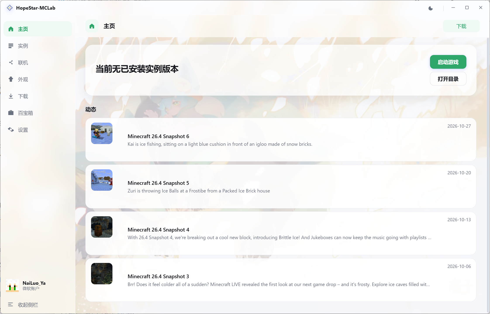
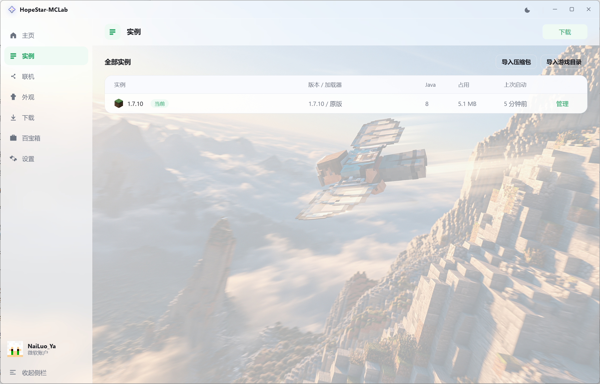
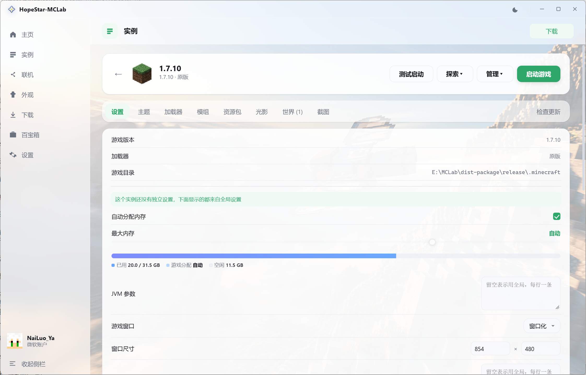
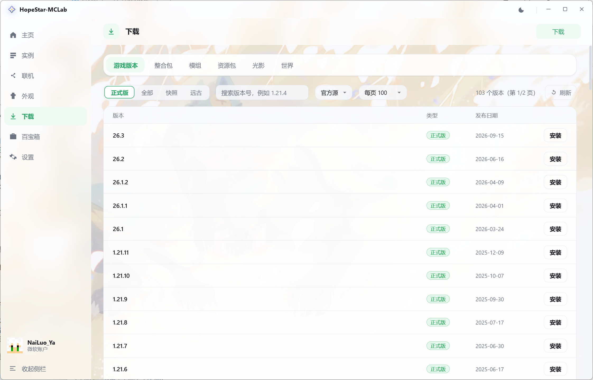
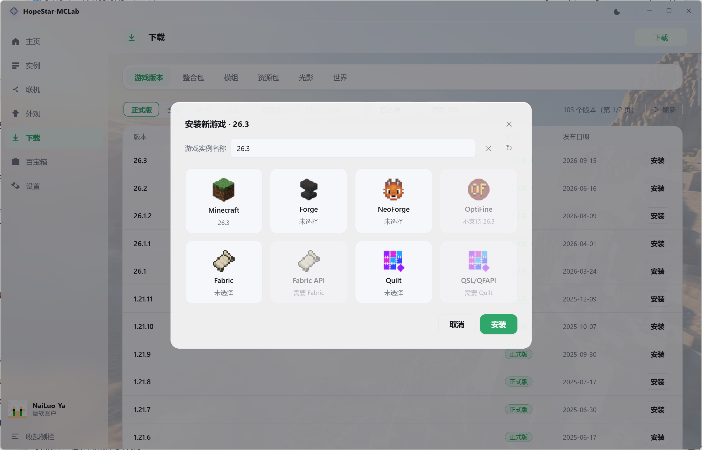
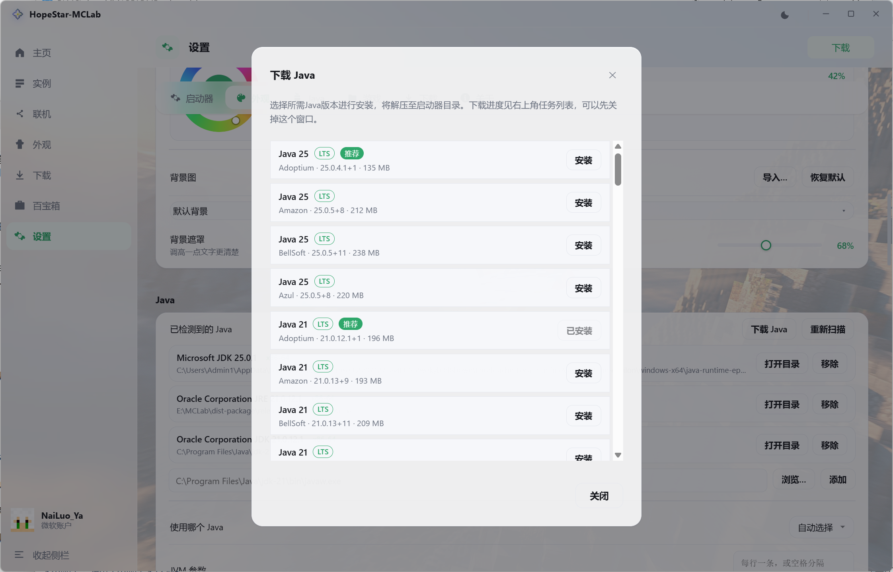
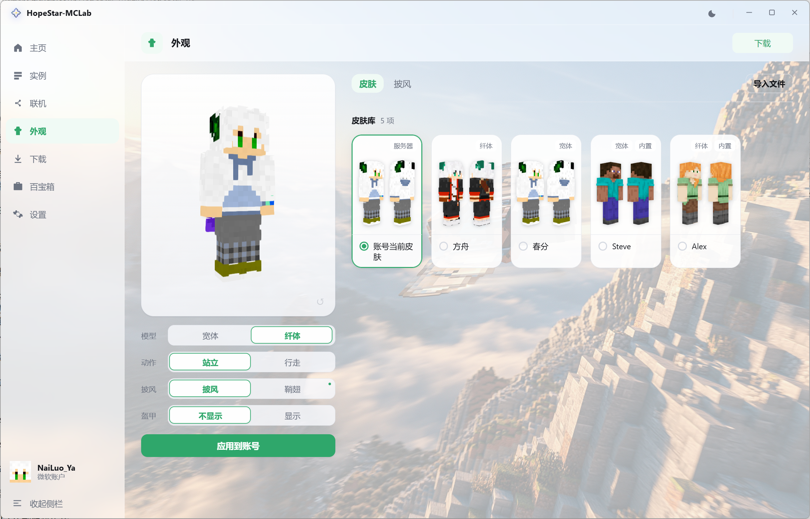
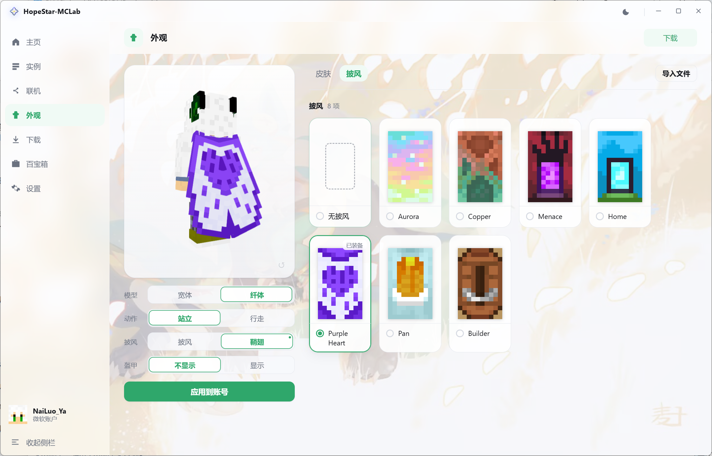
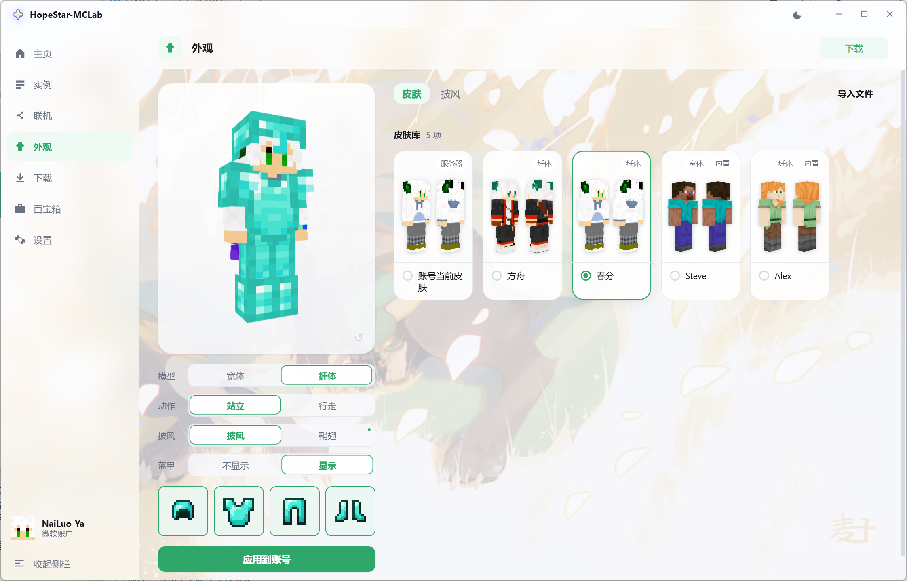
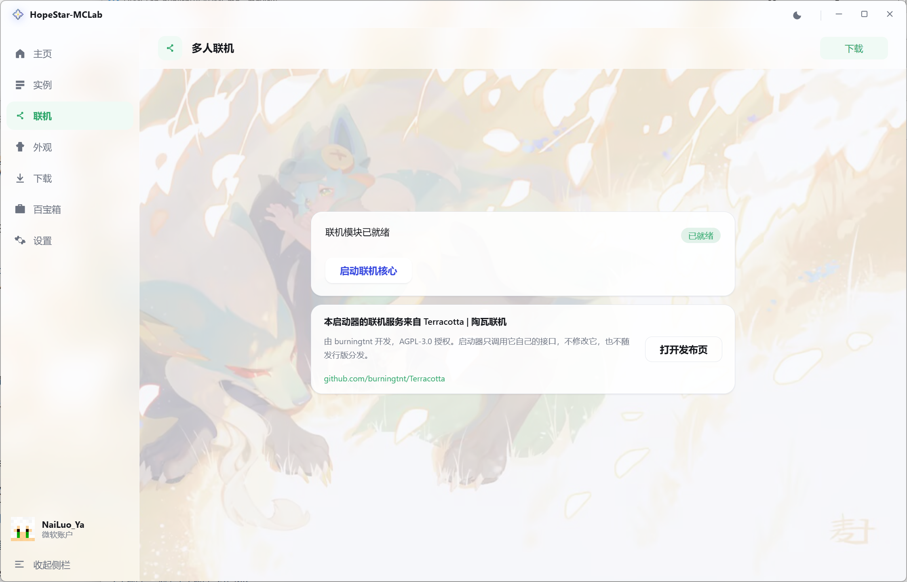

  
  <h1>HopeStar-MCLab</h1>
  
<b>希星，源自黎明前的弱光</b> 
  完整开源 · Windows 10/11 兼容

<!-- #BEGIN COPY -->
<!-- #PROPERTY NAME=BADGES -->

<!-- #END COPY -->

---

在此之前，请先大致浏览本启动器功能~
我们迫不及待想为您呈现一个完善、好用的启动器，即使万花丛生。

- **跳过废话**：→ [点我进入Releases下载！](https://github.com/HopeStar-MuLin/HopeStar-MCLab/releases)

### 首页

- **优先展示上次启动的版本，点击启动游戏即可进入**
- **点击下方卡片切换启动实例，快捷、方便**
- **展示当前来自MoJang的最新动态，点击快速查看**

### 实例管理

- **展示当前安装的所有游戏实例，点击进入管理**
- **已支持所有常用功能，点开即可为实例设置单独配置**

### 下载

- **游戏本体**：完整支持Minecraft可拉取到的所有游戏版本
- **模组加载器**：Forge、Fabric、NeoForge、Quilt、Cleanroom、OptiFine，一键装好
- **整合包**：支持整合包下载与自动安装，支持检测整合包更新并实现在线更新整合包，无需迁移游戏数据
- **模组、资源包、光影、地图**：为游戏添加更多可能性，已支持Modrinth与CurseForge资源站下载
- **Java**：内置Java环境一键安装补全，不再奔波寻找Java安装包

### 皮肤

- **皮肤设置**：为皮肤资源增加完善渲染机制，即使您未进入游戏，亦可查看您的皮肤外观，已支持披风与鞘翅皮肤渲染！~
碎碎念：我们甚至添加了盔甲的渲染预览！

### 联机

-**联机**：感谢**陶瓦联机**[Terracotta](https://github.com/burningtnt/Terracotta) 的伟大开源让多人游戏不再遥不可及，HopeStar-MCLab兼容HMCL多人联机房间码，互通让启动器之间的隔阂不再存在
**本项目遵守AGPL-3.0开源协议，使用Terracotta原生API调用联机功能**

## 下载和安装

1. 到 [Releases](https://github.com/HopeStar-MuLin/HopeStar-MCLab/releases) 下最新的包，两个版本任选：

   | 版本 | 说明 |
   |---|---|
   | `HopeStar-MCLab-*-full.zip` | **自带 Java 21**，解压双击就能用 |
   | `HopeStar-MCLab-*-lite.zip` | 不带 Java，第一次打开自动下载（约 45 MB） |
2. 解压到任意文件夹 —— 别放`C盘`哦！也别`在解压软件双击运行`！
3. 双击 `HopeStar-MCLab.exe`

第一次打开如果弹出「Windows 已保护你的电脑」，点 **更多信息 → 仍要运行**。

**Java 不用自己装。** 两个版本都不需要你手动装：

- **full** 自带精简版 Java 21，无需单独下载适配 Java，可直接引用内置 Java 21 启动游戏；
- **lite** 无内置 Java ，首次启动将自动检测系统中已安装的 Java ，若未能找到可用 Java 将进入自动下载环节。
- **关于游戏内 Java 环境** 下载游戏版本时将自动检查是否存在可用 Java 版本，若未存在将自动为游戏下载精简版 Java

## 关于

免费、开源，本启动器基于 [HMCL](https://github.com/HMCL-dev/HMCL) 作为分支发展，以 GPL-3.0 发布。
完整许可见 [LICENSE](LICENSE)。

### 致谢

千言万语，难掩感激，感谢以下项目让这个启动器成为可能，向开源社区的伟大前辈致敬：
以下名单不分先后，请以启动器-设置-关于页面为准

| 项目 | 作者 | 用在哪 |
|---|---|---|
| [HMCL](https://github.com/HMCL-dev/HMCL) | huangyuhui 及贡献者 | 核心：版本解析、下载、启动、账号 |
| [Tauri](https://github.com/tauri-apps/tauri) / WebView2 | Tauri Contributors / Microsoft | 界面外壳 |
| [skinview3d](https://github.com/bs-community/skinview3d) / [three.js](https://github.com/mrdoob/three.js) | Blessing Skin 社区 / mrdoob 及贡献者 | 3D 皮肤预览 |
| [Modrinth](https://github.com/modrinth/code) / CurseForge | Modrinth 团队 / Overwolf | 模组、整合包、光影数据 |
| [BMCLAPI](https://github.com/bangbang93/BMCLAPI) | bangbang93 | 国内下载镜像 |
| [authlib-injector](https://github.com/yushijinhun/authlib-injector) | yushijinhun | 外置登录 |
| Fabric / Quilt / Forge / NeoForge / Cleanroom / OptiFine | 各自团队 | 模组加载器 |
| [Terracotta](https://github.com/burningtnt/Terracotta) | burningtnt 及贡献者 | 联机模块的伟大加入 |
皮肤、盔甲与物品贴图取自 Minecraft 客户端，版权归 **Mojang Studios**。
